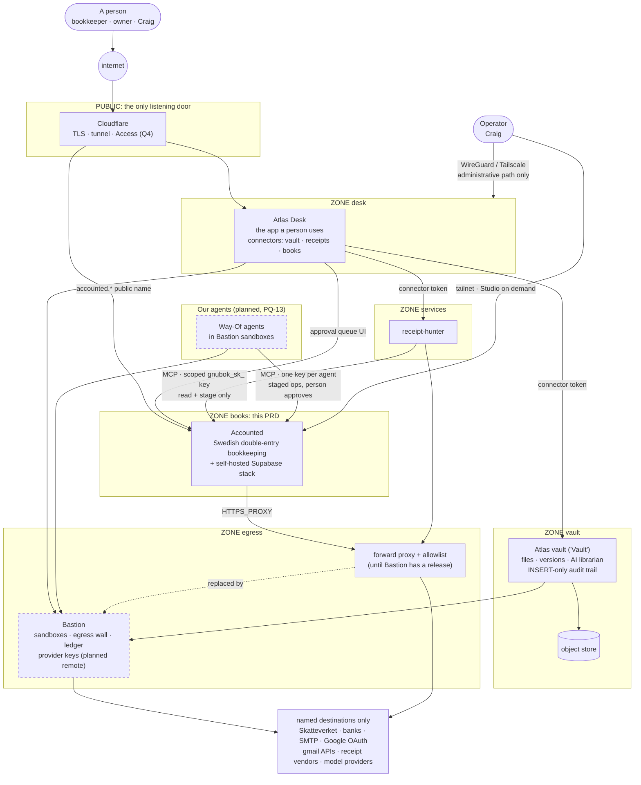
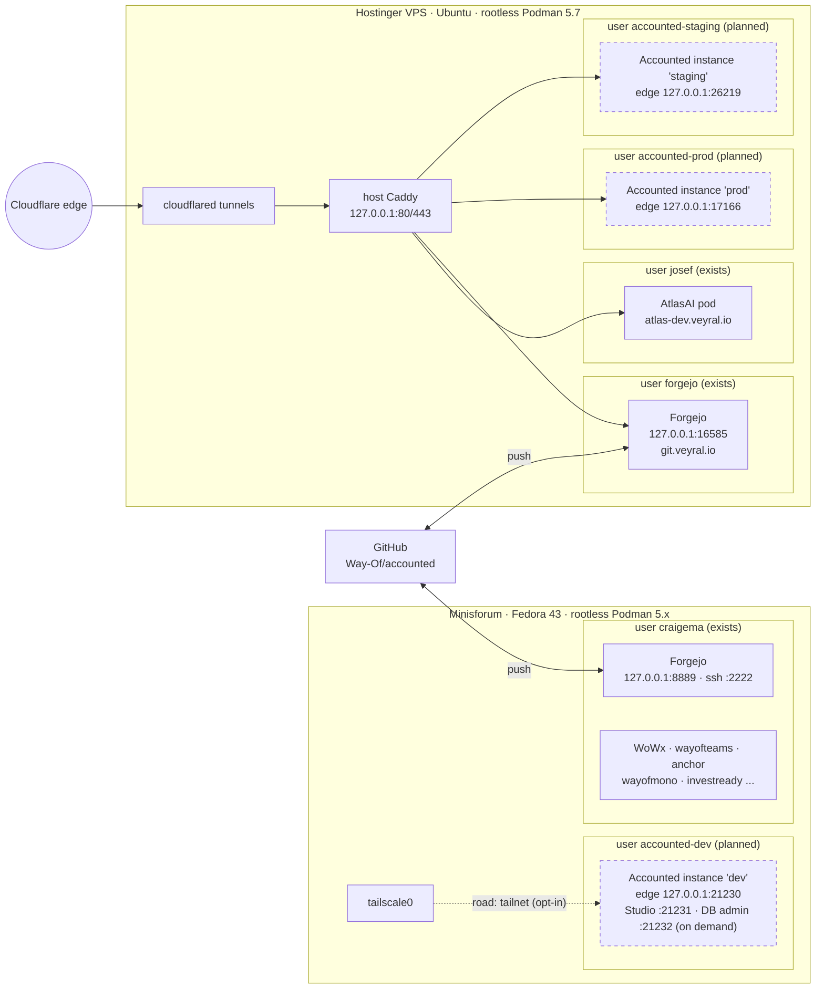
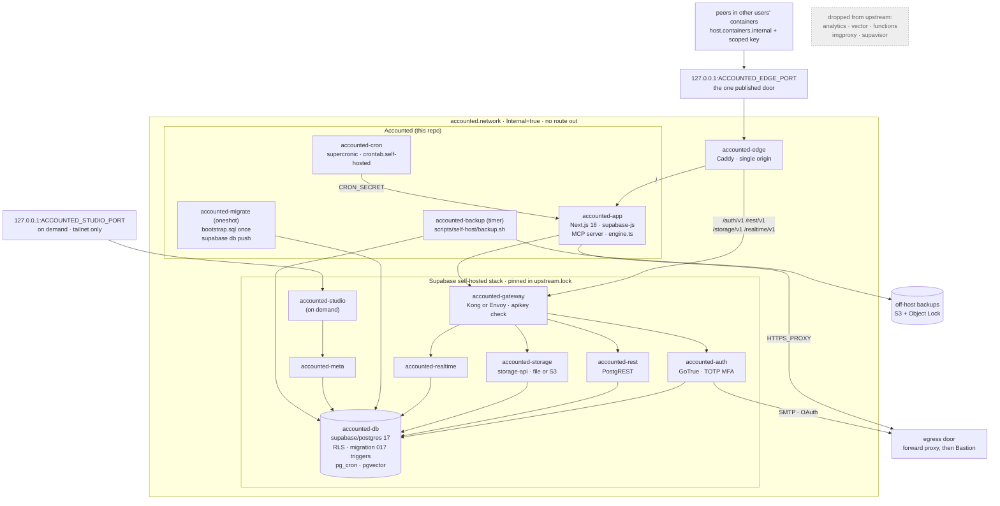
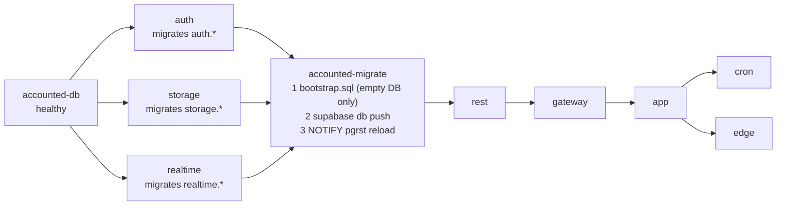
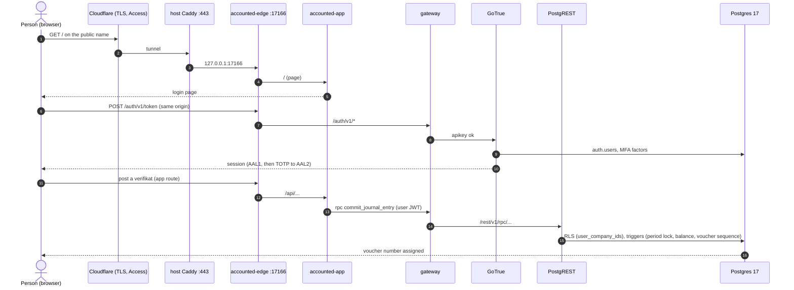

# Architecture: Accounted in the Way-Of Podman estate

**Date:** 2026-11-17 · **Companion to:** [`PRD.md`](PRD.md) (revision 2) · **Tasks:** [`tasks/`](tasks/README.md)

Diagrams-as-code for where Accounted sits among the Way-Of products, what one instance looks like
inside, how it boots, how a request travels, and how the work is delivered. Planned parts are marked
*planned*; everything else exists today. Sources: `atlas-vault/docs/41-hosted-topology.md`,
`atlas-vault/deploy/hostinger/runbook.md`, this repo, and the Minisforum and Hostinger hosts as
measured on 2026-11-17.

## 1. The Way-Of estate (system context)

**The rule that keeps it honest:** a zone reaches only what its row in the topology paper names. Books
reaches nothing directly; everything outbound goes through the egress door.

## 2. Hosts and instances (deployment)

| Instance | Host | Linux user | Port block | Road |
|---|---|---|---|---|
| `dev` | Minisforum | `accounted-dev` | 21230-21237 | none / tailnet |
| `staging` | Hostinger | `accounted-staging` | 26219-26226 | tunnel |
| `prod` | Hostinger | `accounted-prod` | 17166-17173 | tunnel (+ Access, Q4) |

All three blocks were measured free on both hosts on 2026-11-17. One Linux user per instance means
rootless Podman gives each its own containers, networks, volumes and secrets: staging cannot see prod.

## 3. Inside one instance (containers)

## 4. Boot order

Load-bearing: Accounted's migrations reference `auth.users` and `storage.objects`, which GoTrue and
storage-api create in their own migrations.

## 5. A request, end to end (prod)

## 6. Delivery: from this PRD to live

```mermaid
flowchart LR
    subgraph done["2026-11-17 · done in this session"]
      r["research<br/>quadlet conventions · Ymir rules<br/>Atlas topology · Supabase coupling"]
      p1["PRD rev 1<br/>stock Postgres"]
      p2["PRD rev 2<br/>official stack, trimmed, PG 17<br/>instances · port blocks"]
      t["14 task slices<br/>PQ-01..PQ-14"]
      h["HANDOFF.md · DECISIONS.md<br/>Anchor note · this doc"]
      r --> p1 -->|"Craig: Supabase advantages?"| p2 --> t --> h
    end

    subgraph m1["M1 · dev runs"]
      a1["PQ-01 config + blocks"] --> a2["PQ-02 users + installer"] --> a3["PQ-03 secrets"] --> a4["PQ-04 Supabase stack"] --> a6["PQ-06 migrate"] --> a7["PQ-07 app + cron"] --> a8["PQ-08 edge"]
    end
    subgraph m2["M2 · dev proven"]
      a5["PQ-05 PG 17 + pg-real"]
      a9["PQ-09 parity walk"]
      a10["PQ-10 backup + restore"]
      a5 --> a9 --> a10
    end
    subgraph m3["M3 · live"]
      a11["PQ-11 Hostinger staging, then prod"]
    end
    subgraph m4["M4 · estate"]
      a12["PQ-12 books seat"] --> a13["PQ-13 agents (needs Bastion)"]
    end
    a14["PQ-14 docs + CI gates (rides along)"]

    h --> a1
    a4 --> a5
    a8 --> a9
    a10 --> a11
    a9 --> a12
    a4 -.-> a14
    a11 -.-> a14

    subgraph repos["the branch lives in three places"]
      gh["GitHub Way-Of/accounted"]
      f1["Forgejo, Minisforum"]
      f2["Forgejo, Hostinger (git.veyral.io)"]
    end
    h --> repos
```

