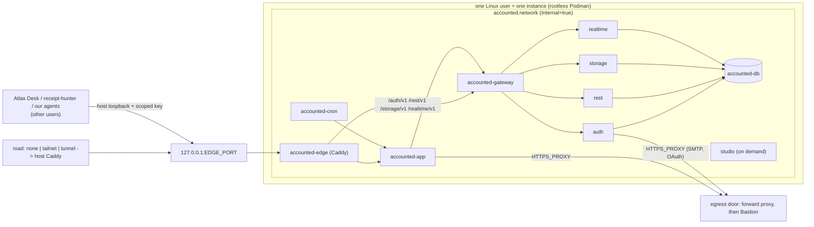

# PRD: Accounted on Podman Quadlet with self-hosted Supabase

**Status:** revision 2, all open questions answered (2026-11-17) · **Date:** 2026-11-17 · **Owner:** Craig · **Branch:** `docs/podman-quadlet-prd`
**Tasks:** [`tasks/`](tasks/README.md) · **Diagrams:** [`ARCHITECTURE.md`](ARCHITECTURE.md) · **Resume point:** [`/HANDOFF.md`](../../../HANDOFF.md)

> **Revision 2 (2026-11-17).** Revision 1 proposed a stock `postgres` image with hand-picked Supabase
> daemons. Replaced by the official Supabase self-hosted stack, trimmed and converted to Quadlets,
> because that is the path this repo already documents and tools (`docs/SELF-HOSTING.md` "Fully
> Self-Hosted", `docs/SOVEREIGN.md`, `scripts/self-host/`) and it removes the drift risk of
> re-creating Supabase's roles and schemas by hand. Rationale in section 5.

## 1. Problem

Accounted runs today on Vercel + Supabase Cloud. The only other documented ways to run it are the
Docker Compose self-host (`docker-compose.yml`, `docs/DOCKER.md`), paired either with a Supabase Cloud
project or with Supabase's official Docker self-hosting stack. Neither is a Podman Quadlet setup.

Way-Of runs its products as rootless Podman Quadlet units on the local Minisforum (Fedora) and the
Hostinger VPS (Ubuntu). The Atlas hosted-topology paper (`atlas-vault/docs/41-hosted-topology.md`)
places Accounted in its own **books** zone, reached by Atlas Desk (approval queue) and receipt-hunter
(MCP with a scoped `gnubok_sk_` key), with egress through **Bastion**. Accounted cannot take that seat
yet: no Quadlet units, no instance model, no network contract.

## 2. Goals

1. **G1 Quadlet-native.** Accounted and its own Supabase stack run as rootless Podman Quadlet units
   under user systemd, from the same unit templates on the Minisforum and on Hostinger. Host and
   instance differences live only in env.
2. **G2 Same approach everywhere (Q5).** The Minisforum runs exactly what Hostinger runs: the
   self-hosted Supabase stack under a dedicated user, installed by the same script. No Supabase Cloud
   project is needed for any Way-Of instance.
3. **G3 Instances.** One host can run several instances (`dev`, `staging`, `prod`), each with its own
   Linux user, port block, secrets, volumes and network, so staging can never touch prod's data.
4. **G4 House law.** Five-digit random port blocks (Rule 07 C), no literal hosts/paths/credentials
   (Rule 07), every door named with a declared road and loopback by default (Rule 24), secrets as
   Podman secrets or 0600 files, private data stays in the house (Rule 26).
5. **G5 Secure seat.** The database and Supabase services sit on an internal network with no route
   out; only the front door is reachable by peers, and each peer authenticates on its own.
6. **G6 Legal parity.** Swedish-law enforcement (migration 017 triggers, period locks, voucher
   sequence, RLS, 7-year retention) behaves identically on hosted and self-hosted. Nothing is weakened
   to make a container start.

## 3. Non-goals

- Rewriting the data layer away from supabase-js.
- A stock-Postgres (non-`supabase/postgres`) variant. Deferred until a concrete need appears (a
  client demanding managed Postgres or a vanilla image); section 5.3 records what it would take.
- Replacing Vercel as the hosted target, or changing the Docker Compose self-host path.
- BankID on self-hosted: hosted-only by design (`src/lib/auth/bankid.ts`).
- Building Bastion or the Atlas vault. We define the seams Accounted exposes to them.
- Running our own agents now. The seat and contract are reserved (section 8).

## 4. Hosts and instances

| Host | OS | Instances | Linux user per instance | Front door (road, Rule 24) |
|---|---|---|---|---|
| Minisforum | Fedora 43, rootless Podman 5.x | `dev` | `accounted-dev` | `none` by default; `tailnet` when opted in |
| Hostinger VPS | Ubuntu, rootless Podman 5.7 (netavark, pasta) | `staging`, `prod` | `accounted-staging`, `accounted-prod` | `tunnel`: Cloudflare tunnel -> host Caddy -> loopback edge port |

- **One user per instance**, with `loginctl enable-linger`. Rootless Podman gives each user its own
  containers, networks, volumes and secrets, so instance isolation comes from the OS, not from naming.
  The Minisforum uses a dedicated user too, so the install path is byte-for-byte the Hostinger one.
- Units are named `accounted-<service>` inside each user (no instance prefix needed, the user is the
  namespace). `ACCOUNTED_INSTANCE` is still set so logs, backups and the register say which one.
- The Hostinger shape follows the proven AtlasAI deployment (`atlas-vault/deploy/hostinger/runbook.md`):
  linger, loopback binds, host Caddy terminating the tunnel. Accounted's users are separate from
  AtlasAI's `josef`, so one product's compromise does not reach another's data.

## 5. Data layer

### 5.1 Decision: the official Supabase self-hosted stack, trimmed, as Quadlets

Profiles: `ACCOUNTED_DATA_PROFILE=supabase-self` (default, every Way-Of instance) or `supabase-cloud`
(the app points at a Supabase Cloud project; supported for other operators, not deployed by us).

Why the official stack beats revision 1's hand-picked one:

| | Official stack | Stock Postgres + picked daemons |
|---|---|---|
| Migrations | run unchanged: CI (`supabase/postgres`), prod and all 1,089 migrations assume its roles, owners and `extensions` schema | we re-create roles/schemas and own that drift on every new migration |
| Version pairing | GoTrue, PostgREST, storage-api, Realtime, Postgres tested together per release | pinned and tested by us |
| Parity with hosted | same server components behind ~5,000 supabase-js call sites | close, not the same |
| Existing tooling | `scripts/self-host/backup.sh` / `restore.sh` / ACL manifest, upstream PG upgrade scripts, Supabase CLI migration ledger | none |
| Extras | Studio, Realtime (used by 4 UI pages) | none |
| Cost | ~12 services upstream, Compose to Quadlet conversion per release, insecure defaults to harden | fewer containers, more of our own code |

### 5.2 The trimmed stack

Pinned to one upstream release (`self-hosted/vX.Y.Z`, recorded in `deploy/podman/upstream.lock` with
image digests). Converted to Quadlet units in `deploy/podman/quadlets/`.

| Unit | Upstream service | Kept? | Why |
|---|---|---|---|
| `accounted-db` | `db` (`supabase/postgres` **17.x**) | yes | the database; init SQL vendored from the pinned release |
| `accounted-auth` | `auth` (GoTrue) | yes | email+password, TOTP MFA, invites, Google OAuth, send-email hook |
| `accounted-rest` | `rest` (PostgREST) | yes | `/rest/v1` |
| `accounted-storage` | `storage` (storage-api) | yes | buckets `documents`, `sie-files`, `logos`, `invoice-fonts`; file backend, S3 optional |
| `accounted-realtime` | `realtime` | yes | 4 UI pages use `.channel(`; keeping it removes a degrade test |
| `accounted-gateway` | `kong` / `envoy` (whichever the release defaults to) | yes | upstream's apikey check and routing, unchanged |
| `accounted-meta` | `meta` (postgres-meta) | yes | needed by Studio only |
| `accounted-studio` | `studio` | on demand | admin UI; started by hand, published on loopback only, reached over the tailnet; never on the tunnel |
| | `analytics` (Logflare), `vector` | **dropped** | heaviest services; `vector` mounts the Docker socket, which breaks the rootless least-privilege model. Logs go to journald |
| | `functions` (edge runtime) | **dropped** | zero `functions.invoke` call sites |
| | `imgproxy` | **dropped** | zero storage transform call sites |
| | `supavisor` (pooler) | **dropped** | nothing in `src/` connects to Postgres directly; all access is HTTP |

Plus Accounted's own units: `accounted-migrate` (oneshot), `accounted-app`, `accounted-cron`,
`accounted-edge`, `accounted-backup` (+ timer).

Dropping `analytics` means also dropping the init SQL that creates the `_supabase` analytics database
and the pooler's schema, and turning off Studio's log pages. PQ-04 confirms nothing else depends on them.

**Postgres 17 (Q3).** Upstream's self-hosted stack defaults to the 17 image since docker 0.6.0 (June
2026, `docs/SOVEREIGN.md` section 4). Every Way-Of instance starts on an empty volume, so there is no
upgrade to run: choosing 17 now avoids the 15 -> 17 upgrade (`utils/upgrade-pg17.sh`, double disk,
pgsodium key backup) we would otherwise owe later. The gap: hosted prod and CI's pg-real job still run
15, so migrations must keep working on both. PQ-04 adds a pg-real run on the 17 image, and a failure on
17 is fixed in a new migration that works on both, never by editing an old one.

**Migrations.** `accounted-migrate` runs, in order: `supabase/bootstrap.sql` once on an empty database
(the repo's own guard for the legacy default grants), then `supabase db push --db-url ...` with a pinned
Supabase CLI binary. The CLI keeps its ledger in `supabase_migrations.schema_migrations`, the same table
Supabase Cloud uses, so CLAUDE.md DoD item 8 reconciliation works unchanged and an orphan version is
refused by the CLI itself. No migration runner of our own.

**Boot order:** `db -> auth, storage, realtime (each migrates its own schema) -> migrate -> rest
(schema reload) -> gateway -> app -> cron, edge`. Accounted's migrations reference `auth.users` and
`storage.objects`, which GoTrue and storage-api create.

**Upstream drift.** `deploy/podman/bin/upstream-diff.sh <tag>` fetches upstream's `docker/` at a tag
and reports image, env-key and init-SQL changes against our units and `upstream.lock`. An upgrade is
that diff reviewed, the lock bumped, and PQ-08's parity walk re-run on `dev` then `staging`.

### 5.3 Deferred: stock Postgres

If a client needs a vanilla or managed Postgres later: `supabase/bootstrap.sql` plus the vendored init
SQL show which roles, schemas and grants must exist; `tests/tool-pg/` proves PostgREST over a migrated
database. Not built now.

## 6. Network architecture

- **One published door per instance.** Only `accounted-edge` publishes, on `127.0.0.1`. Studio and an
  optional database admin port publish on `127.0.0.1` only when explicitly enabled, from the same block.
  The road in front is declared per instance (Rule 24 road law).
- **Single origin.** The edge routes `/auth/v1/*`, `/rest/v1/*`, `/storage/v1/*`, `/realtime/v1/*` to the
  gateway and everything else to the app, so `NEXT_PUBLIC_SUPABASE_URL = NEXT_PUBLIC_APP_URL` and
  GoTrue's `API_EXTERNAL_URL` is `<public URL>/auth/v1`. Verified: Next has `/auth/callback` and
  `/auth/email-change` but no `/auth/v1`, `/rest`, `/storage` or `/realtime` route. PQ-06 adds a test that
  fails if one appears.
- **Internal network.** `accounted.network` is `Internal=true`. Only `app` and `auth` leave, and only via
  `HTTPS_PROXY` to the egress door.
- **Peers come in through the door, not a shared network.** Rootless Podman networks belong to one user,
  so Atlas (another user) cannot join `accounted.network`, and should not. Peers call the instance's
  edge over host loopback (`host.containers.internal` with pasta) and authenticate with their own scoped
  `gnubok_sk_` key. Reachability grants nothing (Rule 24 cross-house law). When products split onto
  separate boxes (topology paper shape B), the same door is reached over WireGuard instead.
- **The public API is the Supabase model.** `/rest/v1` with the anon key and RLS as the gate, as on
  Supabase Cloud today. On the tunnel road, Cloudflare Access in front adds a credential (Q4).

## 7. Configuration, ports and secrets

### 7.1 Port blocks (Rule 07 C)

One random five-digit block per instance, checked free with `ss -ltnH` on the Minisforum and against
every existing Way-Of quadlet on 2026-11-17. Each instance's block is reserved on every host so an
instance can move between hosts without renumbering. PQ-10 re-checks on Hostinger.

| Instance | Block | `+0` edge (published) | `+1` Studio (loopback, on demand) | `+2` DB admin (loopback, on demand) | `+3..+7` |
|---|---|---|---|---|---|
| `prod` | 17166-17173 | 17166 | 17167 | 17168 | reserved |
| `staging` | 26219-26226 | 26219 | 26220 | 26221 | reserved |
| `dev` | 21230-21237 | 21230 | 21231 | 21232 | reserved |

Each port is one env var (`ACCOUNTED_EDGE_PORT`, `ACCOUNTED_STUDIO_PORT`, `ACCOUNTED_DB_ADMIN_PORT`) with
one documented default per instance in `deploy/podman/instances/<instance>.env`; the published port,
the proxy target and the health probe read it.

**Ports inside the internal network (Q10, decided 2026-11-17).** Container ports that are never
published (GoTrue 9999, PostgREST 3000, storage 5000, gateway 8000, the app 3000, ...) keep their image
defaults. Each container has its own network namespace, so they cannot collide with anything on the
host, and renumbering them would fork upstream's gateway config and every service's env on each
release; an intruder already inside the internal network gains nothing from different numbers. The
values live in one file (`deploy/podman/internal-ports.env`) that the units read. Every host-published
port still comes from a five-digit block.

Every block is claimed in the private services register (`$YMIR_HOME/config/services.yaml`, read by
`bin/ward/services-register.sh`) on each host before first bind. The register does not exist on the
Minisforum yet; PQ-01 creates the rows.

### 7.2 Secrets

- **Podman secrets per instance user.** `deploy/podman/bin/secrets-init.sh` generates the JWT secret, the
  `anon` and `service_role` JWTs signed with it, `CRON_SECRET`, the Postgres password, Realtime's and
  Studio's secrets, and replaces every upstream demo key. Units read them with `Secret=...,type=env`.
- Person-supplied values (SMTP, Google OAuth, AI endpoint key) are read once from a 0600 file outside the
  repo. The script refuses a path ending in `.env.local` (CLAUDE.md: that file is production).
- Nothing secret is written into a unit file, an image layer, the repo or the journal.
- **Source of record: open (Q8 reopened).** Today `secrets-init.sh` generates into each instance user's
  Podman store, from `deploy/podman/secrets.manifest`. Whatever Q8 lands on must keep two properties:
  no server on every deployment target, and containers never fetch secrets at start.

### 7.5 Infisical (parked, Q8 reopened)

Kept for the record; not built unless Q8 lands here.

A separate Quadlet stack, not part of any Accounted instance, because other Way-Of products will use it
too. The house already runs it (`wayofteams-infisical`, WoWx's `secrets-init` pulls from it); this is
the hardened, shared instance.

| | |
|---|---|
| Where | Hostinger, Linux user `infisical` (shape A, for now), one instance serving all environments |
| Units | `infisical` (image pinned, starting from the house's `v0.159.25`), `infisical-db` (Postgres), `infisical-redis`; network `infisical.network` (`Internal=true` except the app's SMTP egress) |
| Port block | **24095-24098**: `+0` web/API on `127.0.0.1` only; `+1..+3` reserved. Measured free on both hosts 2026-11-17 |
| Road | `tailnet` for people and for the Minisforum; Accounted users on the same VPS reach it over host loopback. Never on the Cloudflare tunnel |
| Layout | one project `accounted`, environments `dev`, `staging`, `prod`; one machine identity per instance user, read-only, scoped to its environment |
| Secret zero | each instance user's machine-identity credential is the one local secret: a Podman secret, 0600 at rest |
| Root keys | Infisical's `ENCRYPTION_KEY` and `AUTH_SECRET` are written once to an offline, printed or hardware-held copy; losing them loses every secret |
| Backups | its database in the same backup timer pattern as PQ-10, encrypted, off-host |
| Naming | it is **Infisical**, never "the vault": "Vault" is the Atlas document product |

### 7.3 No literal paths

Units reference files through `%h` and env (`ACCOUNTED_DEPLOY_DIR`), never `/home/<user>/`. Ymir's
`compliance-check.sh` config gate must pass on `deploy/podman/`.

### 7.4 Hardening (every unit)

`NoNewPrivileges=true`, `DropCapability=ALL` with only what each image's entrypoint needs added back,
`ReadOnly=true` with explicit tmpfs and volumes where the image allows it, SELinux kept on (`:Z`
volumes, **no** `SecurityLabelDisable`), `HealthCmd` on every long-running unit, memory and pid limits
via `PodmanArgs`, images pinned by digest from `upstream.lock`, `Restart=on-failure`. Studio is never
routed through the edge. `validate-podman` and `quadlet -dryrun -user` pass before install.

## 8. Integration seams (Atlas, Vault, Bastion, our agents)

| Peer | Seam Accounted provides | Credential | In this PRD |
|---|---|---|---|
| Atlas Desk | approval-queue UI and REST through the instance's edge | Way-Of SSO at the edge (D60), Accounted session | door only |
| receipt-hunter | MCP server (`src/extensions/general/mcp-server/`) through the edge | scoped `gnubok_sk_` key, read + stage only | one key minted in PQ-11 |
| Atlas vault ("Vault") | documents stay in Accounted's storage; a vault-backed storage option is later | per-product connector token | out of scope, noted |
| Bastion | the egress door: `HTTPS_PROXY` on app and auth; allowlist names Skatteverket, banks, SMTP, OAuth, AI endpoint | per-session passport (when Bastion stands) | forward proxy first, Bastion later |
| Our agents | MCP through the edge, one scoped key per agent, default 100 RPM, staged operations a person approves | `gnubok_sk_` per agent | seat reserved, PQ-12 |

Agents never get a database credential, never reach Studio, and never hold a model provider key.

## 9. Operations

- **Install:** `deploy/podman/bin/install.sh --instance dev|staging|prod [--road none|tailnet|tunnel]`,
  run as the instance user: renders units into `~/.config/containers/systemd/`, creates secrets,
  `daemon-reload`s, starts in order, and fails if any Accounted socket appears on a non-loopback address.
  The same command on both hosts. Creating the user and enabling linger is a separate printed step for
  Craig (Rule 24: a mend that can lock the operator out is his).
- **Upgrade:** app image -> `accounted-migrate` -> app restart. Supabase release -> `upstream-diff.sh`,
  lock bump, `dev` first, then `staging`, then `prod`.
- **Cron:** reuse the supercronic sidecar (`docker/cron.Dockerfile`, `docker/crontab.self-hosted`).
  `pg_cron` ships in `supabase/postgres` (one migration schedules a job).
- **Backups (Hard Rule 5, BFL 7 kap):** `accounted-backup` + timer wraps the existing
  `scripts/self-host/backup.sh` (dump, ACL manifest, documents, db-config, S3 with Object Lock). The
  restore drill with `scripts/self-host/restore.sh` is part of done.
- **Observability:** `journalctl --user -u accounted-*`; `/api/health` through the edge; the ward's
  `security-audit.sh` and `services-register.sh --measure` clean on each host.

## 10. Success criteria

1. On the Minisforum, as `accounted-dev`, `install.sh --instance dev` brings up Accounted plus its
   Supabase stack from an empty user, and a person can register, enrol TOTP, create a company, post a
   verifikat, upload a receipt, import a SIE file, and see a cron job and a realtime update.
2. `npm run test:pg` passes against the `supabase/postgres` 17 image.
3. On Hostinger, `staging` and `prod` run under their own users behind the tunnel; `ss -ltn` shows
   Accounted only on `127.0.0.1:26219` and `127.0.0.1:17166`; one real verifikat observed on `prod`.
4. A stand-in MCP client in another user's container stages an entry through the edge with a scoped
   key; the database, gateway and Studio are unreachable from it.
5. `docker compose up` and hosted Vercel are untouched.
6. Backup then restore into a fresh instance user reproduces the books, voucher sequence intact.

## 11. Risks

| Risk | Mitigation |
|---|---|
| Compose to Quadlet conversion drifts from upstream | `upstream.lock` + `upstream-diff.sh`; upgrades go `dev` -> `staging` -> `prod` |
| Dropped services (analytics, vector, pooler) are referenced by kept ones | PQ-04 boots the trimmed set and greps init SQL and env; anything needed comes back with a reason |
| A migration behaves differently on PG 17 than 15 | pg-real on 17 (PQ-04); fixes go in new migrations valid on both |
| Upstream demo keys or open defaults leak into a running instance | `secrets-init.sh` replaces every demo key; install refuses to start if a known demo value is present |
| Rootless images expect root-owned paths | per-unit `UserNS`/capabilities found in PQ-04, recorded in the unit, never `SecurityLabelDisable` |
| Memory on the Hostinger VPS with two stacks | trimmed set; measured in PQ-10; staging can be stopped when idle |
| Hostinger is process isolation, not network isolation, and Reygan's books (client data) go on `prod` there (Q6 "for now", Q9) | named limit in the client agreement; trigger to move `prod` to its own box (shape B): a second client, or any finding from the ward on that VPS |
| Infisical becomes the crown jewel and a dependency | pulled at install time only (containers never depend on it at start); root keys held offline; restore drill in PQ-15 |
| Cloudflare Access blocks non-browser clients (external MCP connectors, webhooks) on the tunnel | Access service tokens or a narrow bypass for `/api/mcp` and webhook paths, each listed in PQ-11; peers on the box use loopback and never meet Access |

## 12. Decisions and open questions

| # | Question | Answer / recommendation |
|---|---|---|
| Q1 | Upstream `deploy/podman/` to `erp-mafia/accounted` | **no**: stays in the `Way-Of/accounted` fork; everything lives in new paths so upstream syncs stay clean |
| Q2 | Image surface and licences | **approved 2026-11-17** |
| Q3 | Postgres major | **17** (matches upstream's self-hosted default, no future upgrade owed); pg-real on 17 added |
| Q4 | Cloudflare Access in front of the tunnel road | **yes** for `staging` and `prod`; `dev` stays tailnet-only |
| Q5 | Minisforum approach | **same as Hostinger**: self-hosted stack, dedicated instance user, same installer |
| Q6 | Hostinger: same VPS as AtlasAI, separate users per instance | **yes, for now**; shape B trigger in section 11 |
| Q7 | Shared inter-product network | superseded: rootless networks are per user, so peers use the loopback door with scoped keys |
| Q8 | Secret source after the local generator | **reopened 2026-11-17**: Infisical parked (weight on every client deployment target; debt not worth it at our size). Today: Podman secrets from `secrets-init.sh`, per instance user. Options under review in HANDOFF |
| Q9 | Whose books go on `prod` first; VPS region | **Reygan's books first; the VPS is in the EU.** Client data: a personuppgiftsbiträdesavtal (DPA) with Reygan before go-live, and the BFL 7 kap archive (PQ-10) running before the first real verifikat |
| Q10 | Five-digit rule for internal, never-published container ports | **no**: image defaults inside the netns; published ports only from blocks (section 7.1) |
